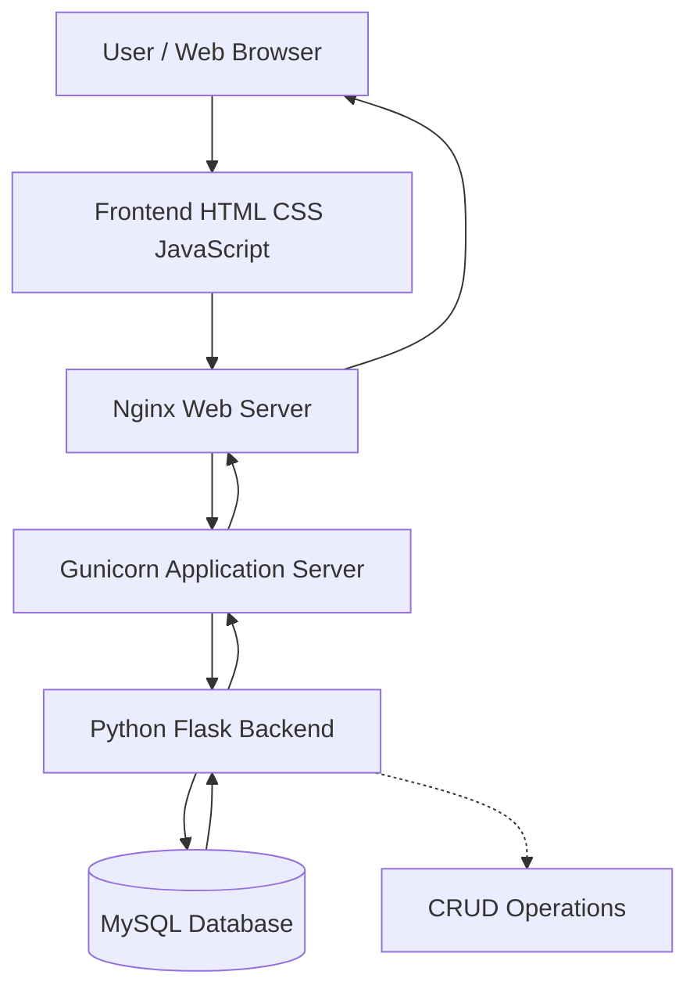
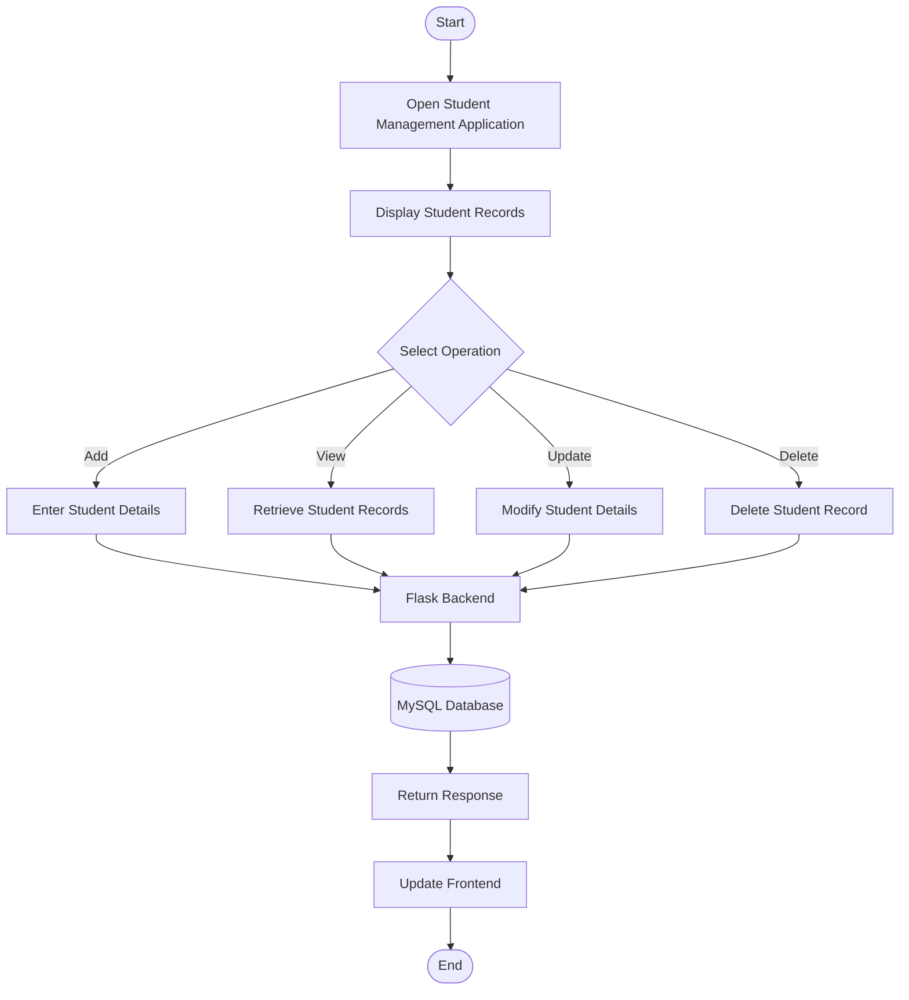
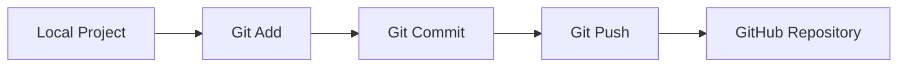
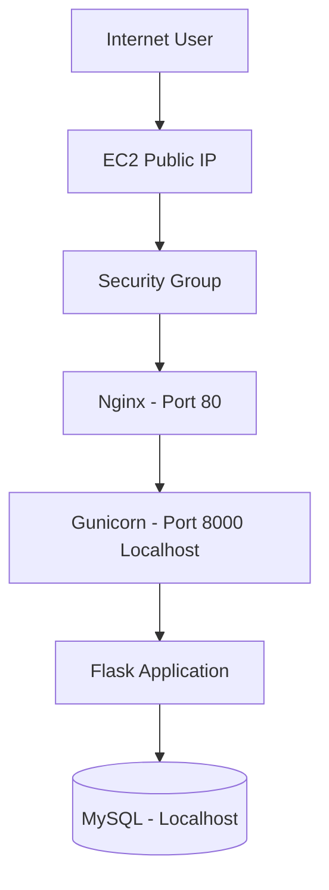
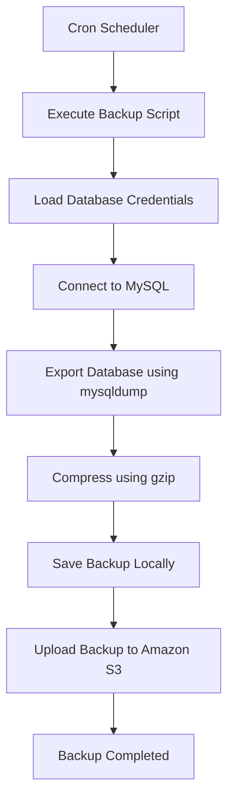
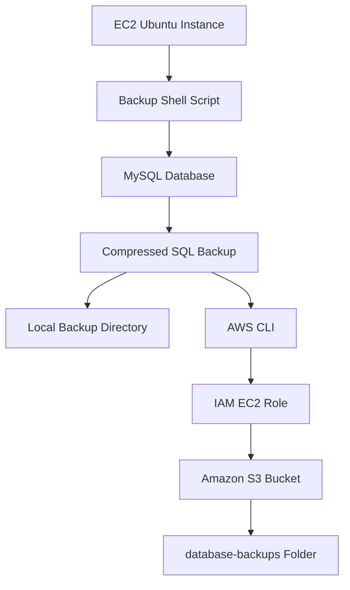

# Student Management System

A web-based Student Management System built using **HTML, CSS, JavaScript, Python Flask, and MySQL**, deployed on **AWS EC2** with automated database backups to **Amazon S3**.

This project demonstrates application development, database management, Linux administration, Git/GitHub version control, AWS deployment, web server configuration, and shell scripting.

---

## 1. Project Overview

The Student Management System is a web application designed to manage student information efficiently.

It allows users to perform CRUD operations:

- **Create:** Add new student records.
- **Read:** View student information.
- **Update:** Modify existing student details.
- **Delete:** Remove student records.

The application uses MySQL to store student information, Flask to handle backend operations, and HTML, CSS, and JavaScript for the frontend.

The application is deployed on an AWS EC2 Ubuntu server and uses Nginx and Gunicorn to serve the Flask application.

Database backups are created automatically using a Shell script and Cron job. The backups are stored locally and uploaded to an Amazon S3 bucket.

---

## 2. Project Objectives

- Develop a functional Student Management web application.
- Implement CRUD operations using Python Flask.
- Connect the application to a MySQL database.
- Manage source code using Git and GitHub.
- Deploy the application on AWS EC2.
- Configure Nginx as a reverse proxy.
- Use Gunicorn as the Flask application server.
- Automate database backups using Shell scripting.
- Schedule daily backups using Cron.
- Store database backups securely in Amazon S3.
- Use IAM roles and policies to provide AWS permissions to EC2.

---

## 3. Technologies Used

| Category | Technology |
|---|---|
| Frontend | HTML, CSS, JavaScript |
| Backend | Python, Flask |
| Database | MySQL |
| Version Control | Git |
| Code Repository | GitHub |
| Cloud Platform | AWS |
| Compute Service | Amazon EC2 |
| Storage | Amazon S3 |
| Access Management | AWS IAM |
| Operating System | Ubuntu Linux |
| Web Server | Nginx |
| Application Server | Gunicorn |
| Automation | Shell Scripting |
| Scheduling | Cron |
| Connectivity | SSH |

---

## 4. System Architecture

The following diagram illustrates the overall architecture of the project.



### Architecture Explanation

1. The user accesses the application through a web browser.
2. The frontend provides the user interface.
3. Nginx receives incoming HTTP requests.
4. Nginx forwards requests to Gunicorn.
5. Gunicorn runs the Flask application.
6. Flask processes requests and communicates with MySQL.
7. MySQL stores and retrieves student records.
8. The response is returned to the user's browser.

---

## 5. Application Workflow



---

## 6. Database Design

**Database Name:** `student_management`

**Table Name:** `students`

### Students Table

| Column | Data Type | Description |
|---|---|---|
| id | INT | Primary key, auto-increment |
| full_name | VARCHAR(100) | Student's full name |
| email | VARCHAR(100) | Student's email address |
| phone | VARCHAR(15) | Student's phone number |
| course | VARCHAR(100) | Student's course |
| gender | VARCHAR(20) | Student's gender |
| created_at | TIMESTAMP | Record creation timestamp |

### SQL Table Creation

```sql
CREATE DATABASE student_management;

USE student_management;

CREATE TABLE students (
    id INT AUTO_INCREMENT PRIMARY KEY,
    full_name VARCHAR(100) NOT NULL,
    email VARCHAR(100) NOT NULL UNIQUE,
    phone VARCHAR(15) NOT NULL,
    course VARCHAR(100) NOT NULL,
    gender VARCHAR(20) NOT NULL,
    created_at TIMESTAMP DEFAULT CURRENT_TIMESTAMP
);
```

---

## 7. Project Directory Structure

The main project components are organized as follows:

```text
student-management-system/
│
├── backend/
│   ├── app.py
│   ├── wsgi.py
│   ├── requirements.txt
│   ├── .env.example
│   └── .env
│
├── scripts/
│   └── backup_database.sh
│
├── .gitignore
└── README.md
```

**Note:** The frontend HTML, CSS, and JavaScript files are part of the application. Update this directory tree if your actual frontend files are stored in separate folders or inside the backend directory.

The `.env` file contains private database credentials and application configuration. It must not be committed to GitHub. Only `.env.example` should be included in the repository.

---

## 8. Local Development Setup

### Prerequisites

Install the following:

- Python
- MySQL Server
- MySQL Workbench (optional)
- Git
- Visual Studio Code (recommended)

### Step 1: Clone the Repository

```bash
git clone https://github.com/bachusahana/student-management-system.git

cd student-management-system
```

### Step 2: Create a Virtual Environment

```bash
cd backend

python -m venv venv
```

Activate it on Windows PowerShell:

```powershell
.\venv\Scripts\Activate.ps1
```

### Step 3: Install Dependencies

```bash
pip install -r requirements.txt
```

### Step 4: Configure Environment Variables

Create a `.env` file inside the backend directory.

Use `.env.example` as a reference.

Example configuration:

```env
DB_HOST=localhost
DB_USER=your_mysql_username
DB_PASSWORD=your_mysql_password
DB_NAME=student_management
FLASK_SECRET_KEY=your_secret_key
FLASK_DEBUG=true
```

Replace the placeholders with your local configuration. Never upload real credentials to GitHub.

### Step 5: Create the Database

Create the `student_management` database and `students` table using the SQL commands in Section 6.

### Step 6: Run the Application

```bash
python app.py
```

Open the local application in your browser using the address displayed by Flask, typically:

```text
http://127.0.0.1:5000
```

---

## 9. Git and GitHub Integration

Git is used to track source code changes, while GitHub stores the remote project repository.

### Git Workflow



### Repository

[Student Management System - GitHub](https://github.com/bachusahana/student-management-system)

### Common Git Commands

```bash
git status

git add .

git commit -m "Update Student Management System"

git push origin main
```

Sensitive files such as `.env`, virtual environments, and Python cache files are excluded using `.gitignore`.

---

## 10. AWS EC2 Deployment

The application is hosted on an Amazon EC2 Ubuntu Linux instance.

### Deployment Architecture



### Deployment Steps

1. Launch an Ubuntu EC2 instance in AWS.
2. Configure a security group to allow required inbound traffic.
3. Connect to the instance using SSH and a private key.
4. Update Ubuntu packages.
5. Install Python, Git, MySQL, Nginx, and other dependencies.
6. Clone the GitHub repository.
7. Create a Python virtual environment.
8. Install backend dependencies.
9. Configure the MySQL database and application user.
10. Create the backend `.env` file on EC2.
11. Test the database connection.
12. Configure Gunicorn to run the Flask application.
13. Configure Nginx as a reverse proxy.
14. Create a systemd service to manage the Gunicorn process.
15. Enable services to start automatically.

### Important Deployment Components

**Nginx:** Receives HTTP requests and forwards them to Gunicorn.

**Gunicorn:** Runs the Flask application.

**MySQL:** Stores student records.

**Systemd:** Manages the application service and restarts it when required.

### Useful Server Commands

Check application service:

```bash
sudo systemctl status student-management
```

Check Nginx:

```bash
sudo systemctl status nginx
```

Check MySQL:

```bash
sudo systemctl status mysql
```

Restart the application:

```bash
sudo systemctl restart student-management
```

Restart Nginx:

```bash
sudo systemctl restart nginx
```

---

## 11. Automated Database Backup

Database backups are important to protect student information from accidental data loss.

A Shell script named `backup_database.sh` is used to:

1. Load database credentials from the backend `.env` file.
2. Create a timestamp for the backup.
3. Export the MySQL database using `mysqldump`.
4. Compress the backup using `gzip`.
5. Save the backup in a local directory.
6. Upload the backup to Amazon S3.

### Backup Workflow



### Backup Script Location

```text
scripts/backup_database.sh
```

### Backup Storage Location

Local backup directory:

```text
/home/ubuntu/database_backups/
```

S3 bucket:

```text
student-management-db-backups-2026
```

S3 backup folder:

```text
database-backups/
```

### Manual Backup Execution

```bash
~/student-management-system/scripts/backup_database.sh
```

### Verify Local Backups

```bash
ls -lh ~/database_backups/
```

### Verify S3 Backups

```bash
aws s3 ls s3://student-management-db-backups-2026/database-backups/ --region ap-south-1
```

---

## 12. Cron Job Scheduling

Cron is used to execute the database backup script automatically every day.

### Configured Schedule

```cron
30 17 * * * /home/ubuntu/student-management-system/scripts/backup_database.sh >> /home/ubuntu/database_backups/backup.log 2>&1
```

This schedule runs every day at:

**11:00 PM IST (17:30 UTC)**

### Cron Explanation

| Field | Value | Meaning |
|---|---|---|
| Minute | 30 | At minute 30 |
| Hour | 17 | At 17:00 UTC |
| Day | * | Every day |
| Month | * | Every month |
| Weekday | * | Every day of the week |

### View Cron Jobs

```bash
crontab -l
```

### Check Backup Logs

```bash
cat ~/database_backups/backup.log
```

---

## 13. AWS S3 and IAM Integration

Amazon S3 is used to store database backups separately from the EC2 server.

### S3 Configuration

- Bucket: `student-management-db-backups-2026`
- Region: `ap-south-1`
- Storage folder: `database-backups/`

### IAM Configuration

An IAM role named:

`StudentManagementEC2S3Role`

is attached to the EC2 instance.

The role uses an IAM policy named:

`StudentManagementS3BackupPolicy`

The policy grants the required permissions:

- `s3:ListBucket` — to list objects in the backup bucket.
- `s3:PutObject` — to upload backup files.

The EC2 instance uses its IAM role to access S3 without storing AWS access keys on the server.

### AWS Backup Architecture



---

## 14. Security Considerations

The project uses the following security practices:

- Database credentials are stored in an environment file.
- `.env` is excluded from GitHub.
- `.env.example` contains placeholders instead of real credentials.
- MySQL is accessed locally by the application.
- The EC2 security group should expose only required public ports.
- SSH access should be restricted to trusted IP addresses.
- The EC2 IAM role provides application access to S3.
- S3 public access should remain blocked.
- The Gunicorn application server listens on localhost behind Nginx.

**Important:** Configure and verify HTTPS and any additional production security controls before using the application with real sensitive student information.

---

## 15. Testing and Verification

The following checks were performed during deployment:

| Test | Expected Result |
|---|---|
| Local Flask application | Application runs |
| MySQL connection | Successful connection |
| Student CRUD operations | Working |
| GitHub repository | Code pushed successfully |
| EC2 SSH connection | Successful |
| MySQL on EC2 | Active |
| Nginx | Active |
| Gunicorn | Active |
| Public application access | HTTP 200 OK |
| Local database backup | Backup file created |
| Backup compression | Valid gzip archive |
| AWS IAM role | Successfully assumed by EC2 |
| S3 upload | Successful |
| S3 backup verification | Backup file visible |
| Cron configuration | Daily schedule configured |

---

## 16. Project Benefits

- Provides a simple solution for managing student information.
- Demonstrates frontend and backend integration.
- Uses MySQL for persistent data storage.
- Demonstrates cloud deployment using AWS EC2.
- Uses Nginx and Gunicorn for application hosting.
- Automates database backups using Shell scripting and Cron.
- Stores backups separately in Amazon S3.
- Demonstrates IAM role-based AWS access.
- Uses Git and GitHub for source code management.

---

## 17. Future Enhancements

The following features can be added in future versions:

- HTTPS using an SSL/TLS certificate.
- Automated CI/CD using GitHub Actions.
- CloudWatch monitoring and alerting.
- Role-based authentication and authorization.
- Improved database backup retention and restore automation.
- Additional student reports and search functionality.

These are potential future enhancements, not features currently included in this implementation.

---

## 18. Conclusion

The Student Management System demonstrates the complete development and manual cloud deployment of a web application using Python Flask, MySQL, and AWS EC2.

The project also demonstrates essential DevOps practices such as Linux administration, Git/GitHub version control, Nginx and Gunicorn configuration, Shell scripting, Cron scheduling, AWS IAM, and S3 backup automation.

The application is deployed and accessible through its EC2 public address, and its database backups are automatically scheduled for local storage and Amazon S3.

---

## Author

**Student Management System**

GitHub Repository: https://github.com/bachusahana/student-management-system